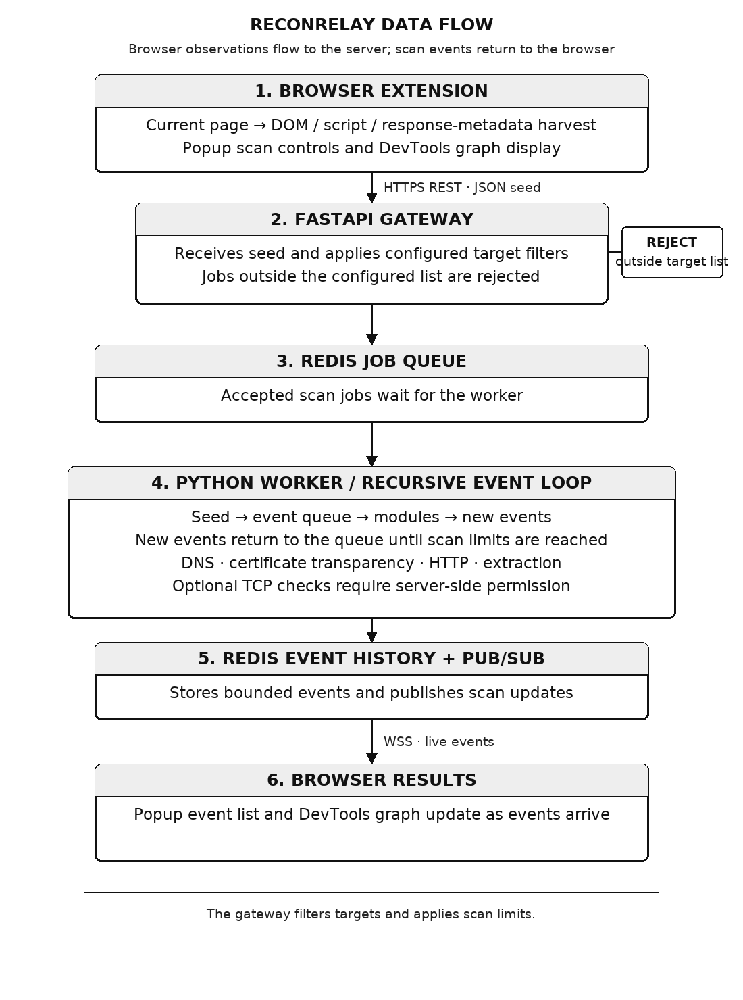

# ReconRelay: A Browser-Extension Reconnaissance Service

**Author:** [Your Name]

**Affiliation:** [School / Department]

**Date:** 20 November 2026

## Abstract

ReconRelay is a small reconnaissance prototype I built to connect information visible in a browser to a server-side discovery workflow. Its extension collects selected page details, including links, script paths, forms, and response headers, then sends them to a FastAPI service. A Python worker filters seeds using the server’s configured target list, follows accepted events within depth and event limits, and stores job data in Redis. The extension shows updates in a popup and a simple graph panel. Active TCP checks are off by default and require a separate server setting. The current tests pass, but they use simulated network responses; they do not prove that the tool finds assets accurately or is ready for public deployment. This paper explains why I built the prototype, how its main parts work, what I tested, and what still needs to be done.

**Keywords:** attack-surface mapping, browser extension, reconnaissance, event processing, WebSocket telemetry

## 1. Introduction

When I inspect a web application, I often find useful clues in the page itself: links, API paths, script files, form actions, hostnames, and technology hints. Collecting these clues by hand is manageable for a small site, but it becomes harder to keep track of them as the list grows. I wanted to try a workflow where the browser gathers the first set of clues and a server follows them up, while showing the results as they arrive.

That idea became ReconRelay. The extension works on the page I am viewing. It sends a seed payload to a FastAPI gateway, where a worker processes the targets accepted by the server and returns events to the extension. I chose this split so the browser could provide page context while the server handled the recursive work and scan limits.

The architecture began as a six-part design: browser client, gateway, queue, execution engine, persistence, and controlled egress [1]. The prototype implements the browser, gateway, queue, engine, and a Redis event store. I have not implemented a VPN or proxy layer. I also left out dedicated graph and relational databases so I could focus on getting the basic job-and-telemetry path working.

## 2. Problem Definition and Project Requirements

The problem I set out to address was straightforward: a browser can reveal useful application details, but those details need to be turned into an organized, bounded scan before they are useful as an attack-surface view. I wanted one path from page inspection to a job that can be monitored, without letting the extension decide what the server may probe.

I had three practical goals. First, harvesting should be convenient but should not send data from every page automatically. Second, the server should process only targets listed in its configuration. Third, recursive work should stop at clear depth, event-count, and time limits. These requirements shaped the extension defaults and the service policy.

The service uses a configured list of domains or address ranges and filters submitted seeds against it. This check happens on the server, not only in the extension. Active TCP probes are also disabled by default and require a separate server setting.

The extension tries to reduce the amount of sensitive data it sends. It removes cookie values, redacts common secret-like strings, and replaces sensitive query parameter values. These checks are best-effort, not a guarantee. A new credential format or an unusual field could still pass through, so the output should be handled as sensitive. Automatic submission is off by default, and the operator can preview a payload before scanning.

## 3. Existing Systems and Project Gap

Security assessment workflows commonly combine scanners, data sources, and result viewers. That flexibility is useful, but an operator may have to move results between tools or manually turn browser observations into scan inputs. I wanted to see whether a small extension could make that hand-off more direct while leaving recursive processing on the server.

### Related Work

BBOT is a public modular reconnaissance scanner that passes structured events between modules [2]. I cite it as prior work for the event-driven approach. ReconRelay is a separate, smaller implementation: it does not include or redistribute that software. The part I explore here is the browser-to-server workflow, together with server-side scope checks and live results in the browser. I have not run a comparative study, so I do not claim that ReconRelay is more accurate or more capable than existing tools.

## 4. Proposed System and Methodology

Fig. 1 summarizes the route from the inspected page to the live event view.

### 4.1 Browser Extension

The extension uses Chrome’s Manifest V3 structure: a service worker, a content script, a popup, an options page, and a DevTools page [3]. The content script reads the current document and collects links, hidden links, forms and field names, script references, inline script hints, and resource entries. It also looks for email-like strings, cloud-storage patterns, and common secret formats. Script files are fetched by the service worker rather than the content script, and only same-site scripts are analyzed, with limits on file count and size.

A `webRequest` listener records selected response headers and URLs that look like API calls or returned an error. It collects metadata, not request bodies, and it cannot block traffic or inspect WebSocket frames [4]. I included a manual scan button and a payload preview in the popup. A small DevTools panel displays the incoming events as a graph. The graph is drawn in the browser from event parent identifiers; it is not stored in a graph database.

The default is manual submission. There is an optional auto-submit setting, but it is off unless the operator enables it. The interceptor keeps a bounded per-tab metadata buffer in session storage, which is removed when the tab closes or a scan consumes it. This keeps the extension’s local footprint limited compared with saving every harvested page to persistent storage.

### 4.2 Gateway and Telemetry

The FastAPI service handles job submission and lookup, event history, cancellation, health checks, and WebSocket telemetry. Before a job is queued, the server applies its configured target list and scan limits. The supplied Nginx example disables access logging for the WebSocket route. In the Compose setup, the API is bound to loopback and Nginx is the public entry point; Redis is not exposed publicly.

### 4.3 Queue, Event Engine, and Persistence

When the gateway accepts a job, it filters the submitted seeds and puts the job on a queue. A worker takes the job and starts an event loop. Seed events enter the queue first. Modules watch selected event types and can emit new events, which may then be handled by other modules. The prototype includes DNS resolution, certificate-transparency lookups, HTTP probing and fingerprinting, response extraction, and an optional small TCP port check. Each event records its type, value, parent, depth, and module.

Redis stores job records, queued identifiers, event history, and publish/subscribe messages [5]. When the browser connects to a job stream, the server subscribes before sending the event history, then continues with live events. This is intended to avoid a gap between the backfill and new results. The client deduplicates events by ID after a reconnect. Full HTTP response bodies are not retained in the event history; a short excerpt and byte count are kept for review.

The original design included Neo4j and PostgreSQL, but I did not build those parts. Redis is the only persistence layer in this version, and event history expires after seven days. I also did not implement WireGuard or proxy rotation. These are clear differences between the initial architecture and the working prototype, rather than features I have tested.

## 5. Implementation Requirements and Deployment

The server is written for Python 3.11 or later and uses FastAPI, Redis, and an ASGI server. The Dockerfile is based on Python’s slim image and is intended to build for ARM64 or AMD64 Linux. Compose runs the API, a worker, and Redis. The Nginx configuration is provided separately as the public TLS reverse proxy. I have not built or run these containers in this environment because Docker was unavailable.

The client is an unpacked Manifest V3 extension for a compatible Chromium browser. Node.js is used to run its tests, but it is not part of the extension at runtime. To deploy the service, an operator must supply an HTTPS hostname and the server’s target list. Redis and the API should remain behind the proxy and must not be exposed directly to the internet.

The Compose file uses one worker and modest memory limits as a starting point. I have not measured the system on an Oracle VM, so I cannot claim a particular free-tier capacity or scan rate. A deployment test on the actual host is still needed to check memory use, restart behavior, TLS, and WebSocket proxying.

## 6. Results and Evaluation

I tested the code with automated tests and fake network responses, not with live targets. The server suite contains 65 tests covering policy, the event engine, API routes, and worker behavior. The extension suite contains 21 Node tests for extraction, URL handling, redaction, header filtering, and graph layout. The project also passed JavaScript syntax checks, manifest and asset checks, a Compose YAML parse, and validation that the generated DOCX has a two-column body.

The tests check important failure cases as well as normal behavior. For example, they verify that an empty target list yields no accepted scan seeds, that derived events only follow an accepted parent, and that a module cannot exceed the event ceiling by returning a large batch. The extension tests check that cookie values and selected secret patterns are redacted. They do not show how often the extractor finds real assets or how often it reports irrelevant ones. The test setup and code are in the project repository [7].

This evaluation is limited. I have not measured discovery precision, false positives, request volume, scan duration, or performance on an Oracle free-tier VM. I have not loaded the extension into a real Chrome profile, and the container deployment has not been run. No external system was scanned. The test results therefore show that the implemented paths behave as expected with controlled fixtures; they do not establish production readiness.

## 7. Discussion, Limitations, and Future Work

The main benefit of this design is that the extension can gather information from the page while the server handles target filtering and scan limits. The same separation also creates risks. The current prototype does not separate job data between different operators, so I would use it as a single-operator service rather than share it with a group.

The module set is intentionally small. There is no vulnerability-template scanner, large-scale port scanner, external Shodan or Whois integration, distributed retry queue, or multi-tenant access control. The interceptor also sees only selected browser metadata; it is not a full network capture tool. Secret redaction is incomplete by nature, and users should not assume that all credentials are removed.

The next useful step is a lab evaluation with pages and domains that I control. I would measure the number of candidate assets found, the number of out-of-scope candidates rejected, false positives, scan time, memory use, and event growth. I would also load the extension in Chrome and run the containers on the intended Oracle instance. Those tests would provide evidence about performance and deployment that unit tests cannot provide.

## 8. Conclusion

I built ReconRelay to try a simple workflow: collect a page’s visible reconnaissance clues in the browser, send them to a server for bounded processing, and watch the resulting events arrive. The prototype includes the extension, FastAPI gateway, Redis queue and event history, a small recursive worker, and a graph view. The server and extension tests pass, but they use controlled fixtures.

The project is not finished as a deployable assessment service. The extension has not been tested in a real browser here, Docker has not been run, and the system has not been evaluated against live targets or on Oracle hardware. The next step is to test it in a controlled lab and record actual discovery, resource, and deployment results. Until then, ReconRelay should be treated as a prototype for authorized testing, not a production scanner.

## References

[1] [Your Name], “Six-Tier Browser Extension and Server Architecture for Reconnaissance,” unpublished project design brief, 2026.

[2] Black Lantern Security, “BBOT: The recursive internet scanner for hackers,” GitHub repository. [Online]. Available: https://github.com/blacklanternsecurity/bbot. Accessed: Nov. 20, 2026.

[3] Google Chrome for Developers, “Manifest V3” and “Extension service worker lifecycle.” [Online]. Available: https://developer.chrome.com/docs/extensions/develop/migrate/what-is-mv3/ and https://developer.chrome.com/docs/extensions/develop/concepts/service-workers/lifecycle/. Accessed: Nov. 20, 2026.

[4] Google Chrome for Developers, “chrome.webRequest API.” [Online]. Available: https://developer.chrome.com/docs/extensions/reference/api/webRequest. Accessed: Nov. 20, 2026.

[5] Redis Ltd., “Redis Pub/Sub” and “Redis Lists.” [Online]. Available: https://redis.io/docs/latest/develop/interact/pubsub/ and https://redis.io/docs/latest/develop/data-types/lists/. Accessed: Nov. 20, 2026.

[6] K. Scarfone, M. Souppaya, A. Cody, and A. Orebaugh, *Technical Guide to Information Security Testing and Assessment*, NIST Special Publication 800-115, Gaithersburg, MD, USA, Sep. 2008, doi: 10.6028/NIST.SP.800-115.

[7] [Your Name], “ReconRelay prototype,” source code, tests, and deployment notes, unpublished software project, 2026. [Online]. Available: project files `reconrelay/server/`, `reconrelay/extension/`, and `reconrelay/README.md`.
