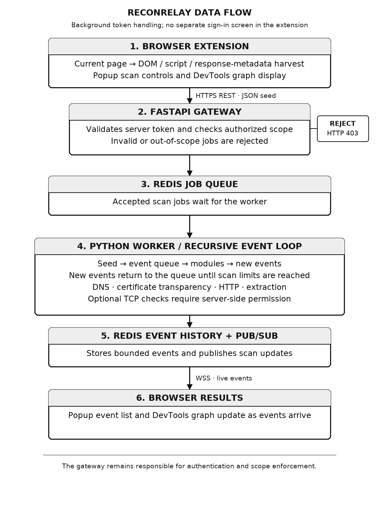

# ReconRelay: A Browser Extension for a Reconnaissance Service

**PROJECT PHASE 1**

**Course Code & Name:** 23SCP501 — Project Phase 1

**Department and Semester:** CSE (Cyber Security) — V

**Academic Year:** 2026–2027

**Submitted by**

Sanjay S — 727623BSC021

Mithrar Muralidharan R — 727623BSC027

Sudhakar K — 727622BSC039

**in partial fulfillment of the requirements for the degree of**

**BACHELOR OF ENGINEERING IN CSE (CYBER SECURITY)**

DEPARTMENT OF CSE (CYBER SECURITY)

DR. MAHALINGAM COLLEGE OF ENGINEERING AND TECHNOLOGY, POLLACHI - 642 003

(AN AUTONOMOUS INSTITUTION AFFILIATED TO ANNA UNIVERSITY, CHENNAI - 600 025)

NOVEMBER 2026

<!-- PAGEBREAK -->

## BONAFIDE CERTIFICATE

**DR. MAHALINGAM COLLEGE OF ENGINEERING AND TECHNOLOGY, POLLACHI - 642 003**

*(AN AUTONOMOUS INSTITUTION AFFILIATED TO ANNA UNIVERSITY, CHENNAI - 600 025)*

Certified that this project report titled **“ReconRelay: A Browser Extension for a Reconnaissance Service”** is the bonafide work of:

Sanjay S — 727623BSC021

Mithrar Muralidharan R — 727623BSC027

Sudhakar K — 727622BSC039

who carried out the project work under my supervision during the academic year **2026–2027**.

| PROJECT GUIDE | HEAD OF THE DEPARTMENT |
|---|---|
| Mrs. Jotheeswari M, M.E., MBA | Dr. P. Vivekanandan, M.Tech., Ph.D. |
| Assistant Professor (SS), Department of CSE (Cyber Security) | Professor and Head, Department of CSE (Cyber Security) |
| Signature: ____________________ | Signature: ____________________ |

Submitted for the Autonomous End Semester Project Viva-Voce Examination held on ____________________.

| INTERNAL EXAMINER | EXTERNAL EXAMINER |
|---|---|
| Signature: ____________________ | Signature: ____________________ |

<!-- PAGEBREAK -->

## DECLARATION

We hereby declare that this project report is an account of work carried out by our team, that the work described is original to this project except where sources are cited, and that this report complies with the applicable institutional guidelines.

| S. No. | Student name and register number | Signature |
|---|---|---|
| 1 | Sanjay S — 727623BSC021 | |
| 2 | Mithrar Muralidharan R — 727623BSC027 | |
| 3 | Sudhakar K — 727622BSC039 | |

**Verified by**

Project Guide: Mrs. Jotheeswari M — ____________________

Head of the Department: Dr. P. Vivekanandan — ____________________

<!-- PAGEBREAK -->

## ABSTRACT

ReconRelay is a prototype that connects information visible in a browser to a server-side reconnaissance workflow. Its Chromium Manifest V3 extension collects selected page details, including links, script paths, forms, and selected response metadata, then submits a seed payload to a FastAPI service. A Python worker filters seeds using a server-configured target list, processes accepted events within depth and event limits, and stores job and event data in Redis. The extension displays updates in a popup and a simple graph panel. The implementation is evaluated with automated tests using controlled fixtures: 65 server tests and 21 extension tests passed in the reported test run. These results verify selected software behaviors, but do not establish real-world discovery accuracy, performance, or production readiness. Docker deployment and live-browser behavior remain to be validated. The report describes the project motivation, architecture, implementation, test results, limitations, and future work.

**Keywords:** browser extension, reconnaissance, event processing, FastAPI, Redis, WebSocket

<!-- PAGEBREAK -->

## ACKNOWLEDGEMENT

We express our sincere gratitude to the management of Dr. Mahalingam College of Engineering and Technology for providing the facilities required to carry out this project. We thank our Principal, Dr. P. Govindasamy, M.E., Ph.D., for his encouragement. We are grateful to Dr. P. Vivekanandan, M.Tech., Ph.D., Professor and Head of the Department of CSE (Cyber Security), and our project coordinator, Mr. S. Saravana Kumar, M.E., Assistant Professor (SS), for their support. We extend our special thanks to our project guide, Mrs. Jotheeswari M, M.E., MBA, Assistant Professor (SS), for her guidance throughout Project Phase 1. Finally, we thank the faculty members, friends, and families who encouraged us during this work.

<!-- PAGEBREAK -->

## TABLE OF CONTENTS

[TOC]

<!-- PAGEBREAK -->

## LIST OF FIGURES

Fig. 1 — ReconRelay workflow: browser extension, gateway, worker, event store, and live results.

## LIST OF TABLES

Table 1 — Automated test results.

## LIST OF ABBREVIATIONS

- API — Application Programming Interface
- DOM — Document Object Model
- HTTP — Hypertext Transfer Protocol
- HTTPS — Hypertext Transfer Protocol Secure
- MV3 — Manifest V3
- Redis — Remote Dictionary Server
- REST — Representational State Transfer
- UI — User Interface
- URL — Uniform Resource Locator
- VM — Virtual Machine
- WebSocket — Full-duplex communication protocol over a single TCP connection

<!-- PAGEBREAK -->

## CHAPTER 1 — INTRODUCTION

### 1.1 Introduction

Web applications expose useful technical clues through their pages and network activity: links, scripts, forms, hostnames, API paths, response headers, and resource references. During a security review, these clues can be useful starting points for mapping an application’s visible attack surface. Gathering them manually and keeping the resulting observations organized can become repetitive as the number of pages and findings grows.

ReconRelay is a prototype that connects a browser extension to a server-side reconnaissance workflow. The extension collects selected information from the page being inspected and submits a seed payload to a FastAPI service. A worker processes accepted seeds through a small set of event-driven modules, stores the resulting events in Redis, and streams updates back to the browser. A popup provides scan controls and a live event view; a DevTools panel presents event relationships as a graph.

The project is intended as a demonstrator of this browser-to-server workflow. It is not a full vulnerability scanner, and the present evaluation uses automated tests with simulated network responses rather than live-target performance measurements.

### 1.2 Problem Definition

A browser provides local context about the page an operator is viewing, while recursive processing and result management are better suited to a separate service. Without a simple hand-off, page observations may need to be copied manually into other tools. The project explores how to collect those observations, submit them as a bounded job, and display resulting events as they arrive.

### 1.3 Project Objectives

- Build a Chromium Manifest V3 extension for deliberate page inspection and scan submission.
- Implement a FastAPI gateway, queue, worker, event store, and live event stream.
- Use configurable target filtering and depth, event-count, and time limits in server-side processing.
- Redact common sensitive values from collected metadata on a best-effort basis.
- Test the principal extension and server behavior with automated tests and controlled fixtures.

### 1.4 Project Overview

The browser extension is the user-facing client. It harvests selected page clues, previews the data, and sends a job to the gateway. The gateway checks the configured target list and resource limits before queueing work. A Python worker processes the job using modular event handlers. Redis stores job and event information and publishes updates. The extension receives events over WebSocket and renders them in a list or graph.

### 1.5 Hardware and Software Requirements

The prototype can be developed on a contemporary desktop or laptop with a Chromium-based browser, Python 3.11 or later, Node.js for extension tests, and Redis for server operation. Docker and Docker Compose are included for deployment, but the container setup has not been validated in the development environment. A modest development machine is sufficient for unit tests; actual deployment capacity depends on the host, network, target response times, and configured scan limits.

Principal software components are Python, FastAPI, Redis, an ASGI server, JavaScript, Chrome Manifest V3, and Node.js built-in test tools. The extension does not need Node.js at runtime.

## CHAPTER 2 — EXISTING APPROACHES AND PROJECT GAP

### 2.1 Existing Approaches

Security assessment workflows often combine browser inspection, command-line scanners, data sources, and separate result viewers. Browser developer tools can expose page and network metadata. Reconnaissance frameworks can automate discovery by processing structured events through modules. These approaches are useful, but moving observations from a browser into a separate scan workflow may involve manual copying and context switching.

### 2.2 Limitations Addressed by This Project

ReconRelay focuses on the workflow gap rather than attempting to replace existing scanners. It provides a browser-side collection point, a server queue for follow-up work, and a live event view. It is intentionally smaller than established reconnaissance platforms and does not claim better detection, coverage, or speed. The project does not include large-scale scanning integrations, a distributed task system, or multi-operator data separation.

### 2.3 Related Work

BBOT is a modular reconnaissance tool that processes structured events [1]. It provides relevant context for event-driven reconnaissance, but ReconRelay is a separate prototype and does not include or redistribute BBOT. Chrome Manifest V3 defines the extension architecture used by the browser client [2]. Redis lists and publish/subscribe provide the simple job and event transport used in this implementation [3].

## CHAPTER 3 — PROPOSED SYSTEM AND METHODOLOGY

### 3.1 System Architecture

The system has five implemented parts: the browser extension, FastAPI gateway, Redis queue, Python worker, and Redis event history/pub-sub. Nginx configuration is supplied as a TLS reverse-proxy example. The API is bound behind the proxy in the Compose configuration; Redis is not intended to be exposed publicly.

### 3.2 Browser Extension

The extension uses a Manifest V3 service worker, content scripts, popup, options page, and DevTools panel. The page harvester collects links, forms and field names, script references, selected inline-script hints, resource entries, and selected technology or secret-like patterns. It includes best-effort redaction for cookie values, common secret patterns, and sensitive query parameters. Redaction is not guaranteed to catch every secret, so collected output should be treated as sensitive.

The default workflow is manual: the operator can preview the payload before submitting it. An optional automatic submission setting is off by default. A `webRequest` listener records selected response metadata and candidate API/error URLs; it does not capture request bodies, block traffic, or inspect WebSocket frames. A DevTools view draws event relationships in the browser from parent identifiers.

### 3.3 Gateway and Job Processing

The FastAPI gateway exposes health, job submission and lookup, cancellation, event history, and WebSocket telemetry endpoints. It filters submitted seeds against a configured target list and applies scan limits before work is queued. Active TCP checks are disabled by default and require a separate server-side setting.

Redis stores jobs and event history and carries queued job identifiers and publish/subscribe updates. A worker consumes jobs and processes events through modules for DNS resolution, certificate-transparency lookups, HTTP probing and fingerprinting, response extraction, and an optional small TCP port check. Events record attributes such as type, value, parent, depth, and producing module. Depth, event-count, and time ceilings bound recursive processing.

### 3.4 Data Flow

1. The operator opens a page and invokes the extension.
2. The extension extracts selected page clues and offers a payload preview.
3. The extension submits a seed payload to the FastAPI gateway.
4. The gateway applies configured target filters and job limits.
5. Accepted jobs enter the Redis queue and are processed by a Python worker.
6. The worker emits events, which are recorded and published through Redis.
7. The browser receives events over WebSocket and updates the list and graph views.

### 3.5 Privacy and Operational Considerations

The extension minimizes automatic collection by defaulting to manual submission and preview. However, it processes information from the inspected page and may send it to the configured service. Redaction is best-effort and does not guarantee that sensitive information is removed. Deployments should use HTTPS, protect configuration secrets, keep Redis behind the service boundary, and limit testing to systems within the operator’s permitted test scope. The current prototype is intended for a single operator, not a shared multi-tenant service.

## CHAPTER 4 — IMPLEMENTATION

### 4.1 Extension Implementation

The extension is located in `reconrelay/extension/`. Its content scripts inspect the active page; the service worker coordinates collection and server communication; the popup provides preview and scan controls; the options page stores service configuration; and the DevTools panel renders event relationships. The JavaScript source is plain extension code and does not require a build step for local loading.

### 4.2 Server Implementation

The server is located in `reconrelay/server/`. FastAPI provides HTTP and WebSocket routes, while a worker executes queued jobs. Redis is used for queueing, job state, event history, and pub/sub. The repository includes Docker and Compose configuration and an Nginx reverse-proxy example. Container deployment has not been run or validated in the development environment because Docker was unavailable.

### 4.3 Deployment Outline

For local development, install the Python server dependencies, start the server with a local test configuration, and load `reconrelay/extension/` through `chrome://extensions` using Developer mode and **Load unpacked**. Configure the server URL in the extension options. For remote deployment, configure HTTPS, a strict target list, independent strong secrets, and a reverse proxy; do not expose Redis directly. The repository README contains the detailed deployment steps.

## CHAPTER 5 — RESULTS AND TESTING

### 5.1 Test Method

Testing used automated unit and integration tests with controlled fixtures. No external targets were scanned. The server tests exercise policy, API routes, worker behavior, and event processing. The extension tests cover extraction, URL handling, redaction, header filtering, and graph layout.

### 5.2 Test Results

At the time of the reported test run, the server suite completed with 65 passing tests and the extension suite completed with 21 passing tests. The tests also cover selected failure cases, including empty target configuration, event ancestry constraints, event ceilings, and redaction of cookie values and common secret patterns. These results show expected behavior under the test fixtures; they do not measure real-world detection accuracy or operational performance.

| Component | Test coverage summary | Result |
|---|---|---|
| FastAPI server and worker | Policy, routes, queue/worker behavior, event processing | 65 tests passed |
| Browser extension | Harvesting, URL handling, redaction, metadata filtering, graph layout | 21 tests passed |

### 5.3 Evaluation Limitations

No precision, recall, false-positive rate, discovery coverage, scan duration, request volume, or production throughput has been measured. The extension has not been validated in a real Chrome profile in the recorded test run. Docker deployment and the proposed cloud-host deployment have not been executed. The project therefore demonstrates tested software paths, not production readiness or a quantified security-detection capability.

## CHAPTER 6 — CONCLUSION AND FUTURE WORK

### 6.1 Conclusion

ReconRelay demonstrates a browser-extension-to-server workflow for collecting selected page clues, processing them as bounded jobs, and displaying resulting events in real time. Its implementation combines a Manifest V3 extension, FastAPI gateway, Redis queue and event store, a modular Python worker, and a browser graph view. Automated tests pass against controlled fixtures, but further browser, deployment, and controlled-lab evaluation is required before drawing conclusions about field performance.

### 6.2 Future Work

- Load and test the extension in supported Chromium browsers, including its permission prompts and WebSocket reconnect behavior.
- Build and run the container deployment; verify TLS termination, service restart behavior, resource use, and backups.
- Conduct a controlled lab evaluation using systems maintained by the project team, reporting asset coverage, false positives, processing time, and resource consumption.
- Improve multi-user isolation, operational logging, retention controls, and secret handling before any shared deployment.
- Review browser permissions and data disclosures before publishing the extension through a public extension store.

## REFERENCES

[1] Black Lantern Security, “BBOT: The recursive internet scanner for hackers,” GitHub repository. Available: https://github.com/blacklanternsecurity/bbot.

[2] Google Chrome for Developers, “Manifest V3” and “Extension service worker lifecycle.” Available: https://developer.chrome.com/docs/extensions/develop/migrate/what-is-mv3/ and https://developer.chrome.com/docs/extensions/develop/concepts/service-workers/lifecycle/.

[3] Redis Ltd., “Redis Pub/Sub” and “Redis Lists.” Available: https://redis.io/docs/latest/develop/interact/pubsub/ and https://redis.io/docs/latest/develop/data-types/lists/.

[4] K. Scarfone, M. Souppaya, A. Cody, and A. Orebaugh, *Technical Guide to Information Security Testing and Assessment*, NIST Special Publication 800-115, Sep. 2008. doi: 10.6028/NIST.SP.800-115.

## APPENDIX A — PROJECT FILES

- `reconrelay/extension/` — Manifest V3 client and JavaScript tests.
- `reconrelay/server/` — FastAPI application, worker, modules, and tests.
- `reconrelay/docker-compose.yml` — API, worker, and Redis service definitions.
- `reconrelay/deploy/nginx.conf` — example reverse-proxy configuration.
- `reconrelay/README.md` — local test and deployment instructions.

## APPENDIX B — TEST COMMANDS

From the repository root, run the server test suite with:

`python -m pytest -q -p no:cacheprovider reconrelay/server`

Run extension tests with:

`node --test reconrelay/extension/tests/*.test.js`

Tests use controlled fixtures and should not be interpreted as permission to test systems outside the operator’s permitted scope.
